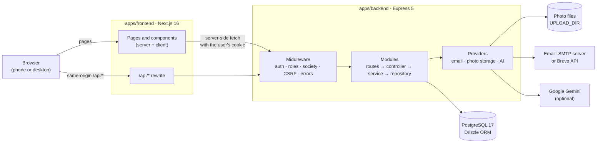
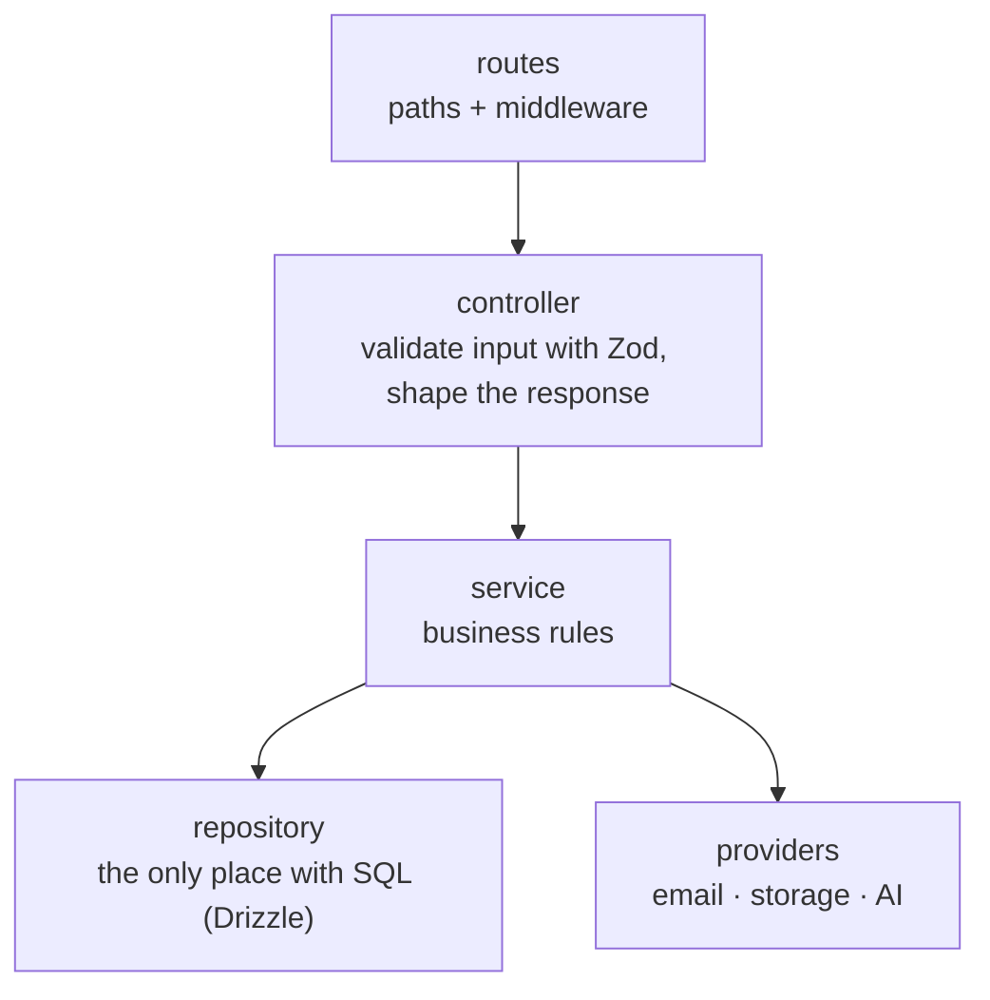
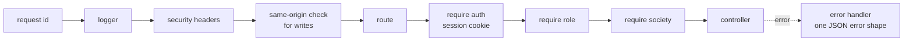
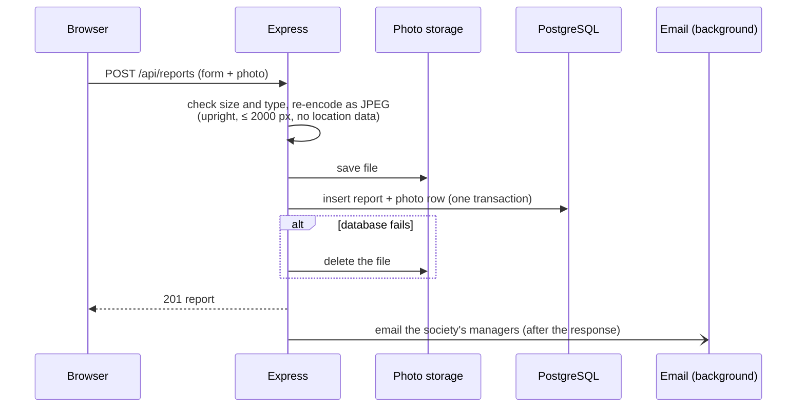

# MyArea Architecture

MyArea is an npm Workspaces monorepo with two apps: a **Next.js** frontend and an **Express** API backed by **PostgreSQL**.

## Overview



- The browser only ever talks to the frontend's origin. Next.js forwards `/api/*` to the backend (`API_BASE_URL`), so cookies stay first-party and the backend address is never sent to the browser.
- The backend is the only authority: it checks the session, the role and the society on every request. The frontend's checks only decide what to show.

## Repository layout

```text
myarea/
├── apps/
│   ├── frontend/                 Next.js app
│   │   └── src/
│   │       ├── app/              routes: (auth) login and invite, (app) signed-in pages
│   │       ├── components/       ui · layout · reports · admin · auth · theme
│   │       ├── lib/              api-client (browser), server/ (session, backend fetch)
│   │       ├── types/api.ts      API response types
│   │       └── proxy.ts          sends visitors without a session to /login
│   └── backend/                  Express API
│       ├── src/
│       │   ├── app.ts            builds the app: middleware + routers
│       │   ├── server.ts         starts it
│       │   ├── config/           environment, validated at startup
│       │   ├── db/               Drizzle client, schema, migrations runner, seed
│       │   ├── middleware/       request id, logging, auth, roles, society, CSRF, upload, errors
│       │   ├── modules/          one folder per feature (below)
│       │   ├── providers/        email, photo storage, AI suggestions
│       │   └── lib/              errors, passwords, tokens, cookies, pagination, logger
│       ├── drizzle/              SQL migrations
│       ├── scripts/              CLI: create-admin, seed
│       └── test/helpers/         test app, in-memory fakes, factories, images
└── package.json                  workspace scripts (dev, check, test, build)
```

## Backend

### Layers
Each feature module has the same layers, and each layer only calls the one below it:



Services receive their repositories and providers as arguments. Tests can therefore run the real HTTP app against in-memory fakes, while integration tests run the repositories against a real PostgreSQL test database.

### Modules

| Module | Endpoints | Who |
|---|---|---|
| `auth` | `/api/auth`: login, logout, current user, invite lookup and accept | everyone |
| `societies` | `/api/societies`: list, create, view, edit | admin |
| `users` (members) | `/api/societies/:societyId/members`: list, invite, resend, change role, disable | admin (any society), manager (own society, residents only) |
| `reports` | `/api/reports`: create with photo, list, detail, status change, resolution photo, thumbs-up | society members; status changes by managers |
| `management` | `/api/management/stats`: counts per status | manager |
| `media` | `/api/media/:id`: serves a photo | members of the photo's society |
| `suggestions` | `/api/reports/suggest`, `/api/features`: AI autofill | society members |
| `notifications` | (no endpoint) new-report emails to managers | – |
| `health` | `/health` | anyone |

### What every request goes through



- **Sessions:** a random token in an httpOnly cookie. Only its SHA-256 hash is stored. Sessions last 7 days.
- **Roles:** `ADMIN` runs societies from outside them (no society); `MANAGER` and `RESIDENT` each belong to one society.
- **Society scoping:** every query for reports, photos or members is filtered by the society. Something from another society answers 404, exactly like something that doesn't exist.
- **Errors:** one shape, `{ error: { code, message, details?, requestId } }`.

### Creating a report



### Providers

| Provider | Implementations | Notes |
|---|---|---|
| Email | SMTP (nodemailer), Brevo (HTTPS API), console | Brevo is for hosts that block SMTP ports; console prints emails to the log for local development |
| Photo storage | local disk (`UPLOAD_DIR`) | Files are named by the photo's id; served only through the API |
| AI suggestions | Google Gemini (REST) | Optional; off without `GEMINI_API_KEY` |

## Frontend

- **Next.js App Router** with Cache Components. Pages are server components that fetch from the API using the visitor's cookie (`lib/server/backend.ts`). Forms and buttons are client components that call `/api/*` (`lib/api-client.ts`).
- **Route groups:** `(auth)` holds `/login` and `/invite`, and `(app)` holds the signed-in pages.
- **Access:** `proxy.ts` sends visitors without a session cookie to `/login`. Each page then asks the API who the user is (`requireUser`, `requireMember`, `requireRole`, `requireAdmin`) and redirects if the user may not see it.

| Who | Pages |
|---|---|
| Admin | `/admin/societies`, `/admin/societies/new`, `/admin/societies/[id]` (members and details), `/profile` |
| Manager | `/`, `/reports`, `/reports/new`, `/reports/[id]`, `/management`, `/members`, `/profile` |
| Resident | `/`, `/reports`, `/reports/new`, `/reports/[id]`, `/profile` |

- **UI:** Tailwind CSS v4 with design tokens; light and dark themes; mobile-first (a bottom tab bar on phones, a pill nav on wider screens).

## Testing

| Level | Tool | Runs against |
|---|---|---|
| Backend unit + HTTP | Vitest + Supertest | the real Express app with in-memory fakes |
| Backend integration | Vitest | a real PostgreSQL test database (`myarea_test`) |
| Frontend | Vitest + React Testing Library | components in jsdom |

`npm run check` runs typecheck, lint, tests and build for both apps. External services (email, Gemini) are never called in tests.
