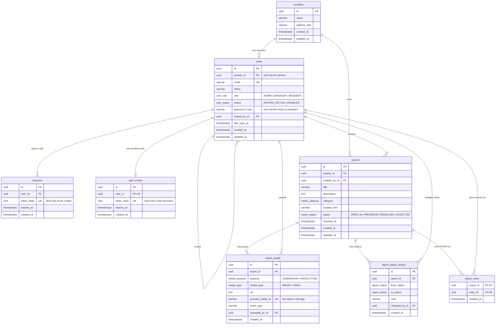
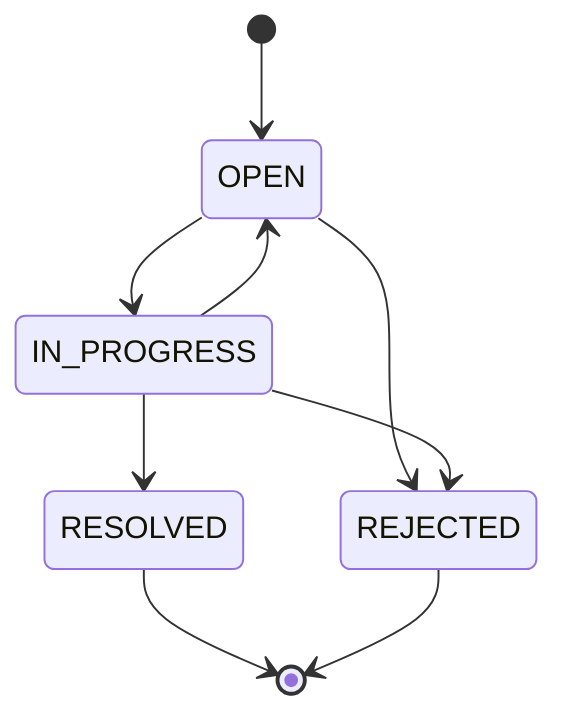

# MyArea Database

PostgreSQL 17, managed with Drizzle ORM. The schema lives in `apps/backend/src/db/schema/`, and migrations in `apps/backend/drizzle/` (`npm run db:migrate -w backend`).

## How the tables connect

## Tables

| Table | What it holds | Connected to |
|---|---|---|
| `societies` | A residential society: name and address | its members (`users`) and its `reports` |
| `users` | Everyone who can sign in, with a role and a status | a society (except admins), the person who invited them, their sessions, invite, reports, photos, status changes and votes |
| `sessions` | Signed-in browsers. Only a hash of the cookie is stored. Expired rows are deleted by the backend at startup and every 6 hours | one user; deleted with the user |
| `user_invites` | The pending invite link for a new member (at most one per user) | one user; deleted when accepted, replaced when resent |
| `reports` | An issue reported in a society | the society, and the reporter (who must be in that society) |
| `report_media` | Where each photo is stored. The file itself is on disk | a report and the person who uploaded it |
| `report_status_history` | Every status change, with an optional note shown to residents | a report and the manager who changed it |
| `report_votes` | Thumbs-up, one per person per report | a report and the voter |

## Rules the database enforces

- **One account per email**, across the whole app (`users_email_uq`).
- **Admins belong to no society; everyone else belongs to exactly one.** `users_society_required_ck`: `(role = 'ADMIN') = (society_id IS NULL)`.
- **A reporter must be a member of the report's society.** `reports(society_id, created_by_id)` references `users(society_id, id)`.
- **An active user has a password** (`users_active_has_password_ck`).
- **`resolved_at` is set exactly when the status is `RESOLVED`** (`reports_resolved_at_ck`).
- **A status change really changes the status**: `from_status <> to_status`.
- **One thumbs-up per person per report**: the primary key is `(report_id, voter_id)`.
- **Tokens are stored only as hashes**, and each is unique (`sessions_token_hash_uq`, `user_invites_token_hash_uq`).

## What happens on delete

| When this is deleted | These go with it | These block the delete |
|---|---|---|
| a society | – | its users and reports |
| a user | their sessions and invite | their reports, photos, status changes and votes. Users are disabled, never deleted |
| a report | its photos, status history and votes | – |

## Enums

| Enum | Values |
|---|---|
| `user_role` | `ADMIN`, `MANAGER`, `RESIDENT` |
| `user_status` | `INVITED`, `ACTIVE`, `DISABLED` |
| `report_category` | `ROADS`, `STREETLIGHTS`, `WASTE`, `WATER_DRAINAGE`, `PARKS`, `NOISE`, `SAFETY`, `OTHER` |
| `report_status` | `OPEN`, `IN_PROGRESS`, `RESOLVED`, `REJECTED` |
| `media_type` | `IMAGE`, `VIDEO` |
| `media_purpose` | `SUBMISSION` (the reporter's photo), `RESOLUTION` (proof of the fix) |

## Status flow

Resolved and Rejected are final. Only managers change a report's status. Each change adds a row to `report_status_history` in the same transaction, with the report row locked so that two simultaneous changes can't both succeed.

## Migrations

| # | Change |
|---|---|
| 0000 | `societies`, `users`, `sessions`, `user_invites` |
| 0001 | `reports`, `report_media` |
| 0002 | `report_status_history` |
| 0003 | `report_votes` |
| 0004 | `report_media`: drop size, dimension and file-name columns |
| 0005 | Admins belong to no society |

To change the schema: edit `apps/backend/src/db/schema/`, run `npm run db:generate -w backend -- --name <change>`, read the generated SQL, then `npm run db:migrate -w backend`.
